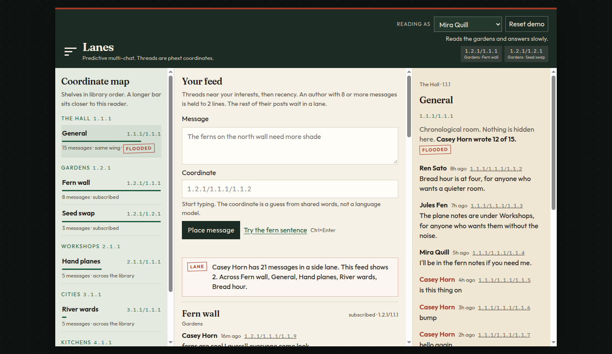
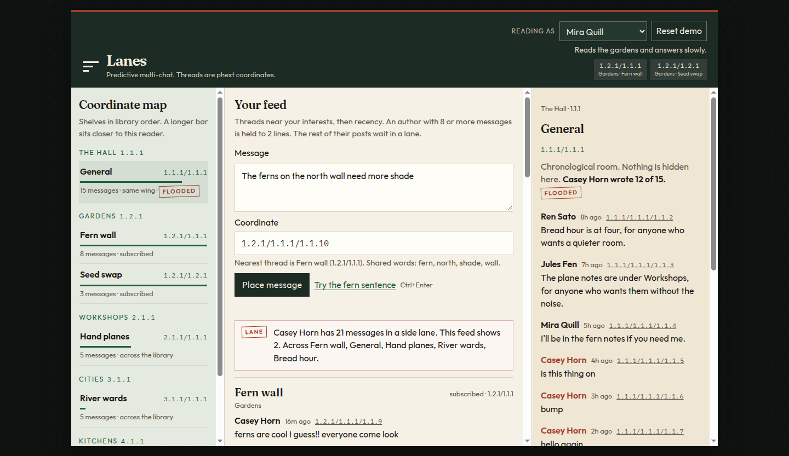

# Lanes

Predictive multi-chat, stored as one [phext](https://phext.io) file.

Group chat has two failure modes. A few enthusiastic people drown everyone else out, and a small room goes silent because it feels rude to talk past them. Lanes keeps every message, but it does not put every message on every screen. A message lands at a coordinate. Each reader has a few coordinates they care about. Their feed is the neighborhood of those coordinates, and anyone who posts constantly is given a lane instead of the page.

The cast is fictional: Mira Quill, Jules Fen, Ada North, Ren Sato, and Casey Horn. Casey is the hyper-poster.



## Demo

`cargo run` serves the reading room and, the first time, writes `data/chat.phext`.

1. Open the page. You are Mira Quill. Her interests are the two garden threads, so **Fern wall** and **Seed swap** lead the feed. The Hall is only "same wing."
2. The red lane says Casey Horn has 21 messages held back. The feed shows 2 of them.
3. The room on the right is the Hall, chronological and uncut. Casey wrote 12 of 15. The three notes above that wall are Ren, Jules, and Mira leaving for quieter coordinates. In Mira's feed those three are the Hall, and Casey's twelve are the lane.
4. Press **Try the fern sentence**. The coordinate field fills with the next scroll of Fern wall, because the words overlap that thread (`fern`, `shade`, `north`, `wall`). Place it. The scroll is appended in the phext.
5. Switch **Reading as** to Casey Horn. The Hall rises to the top, because that coordinate is his interest. He still only gets two lines, so Mira, Jules, and Ren stay visible under him.
6. Click any row in the coordinate map to open that room. **Reset demo** (click twice) or `cargo run -- seed` restores the cast.



On a narrow screen the same three surfaces are tabs: Feed, Map, Room.

## Run

```bash
cargo run
# http://127.0.0.1:7841
```

The listen port defaults to **7841**. The phext path defaults to `data/chat.phext`.

```bash
cargo run -- --port 7841 --file data/chat.phext
cargo test
```

Count the dimension breaks in the file:

```bash
python3 -c "d=open('data/chat.phext','rb').read(); print({hex(b): d.count(bytes([b])) for b in (0x01,0x17,0x1c,0x1f)})"
```

You should see scroll breaks (`0x17`) between messages, a shelf break (`0x1f`) between the Hall and the gardens, a volume break (`0x1c`) between Fern wall and Seed swap, and library breaks (`0x01`) between topics.

## CLI

```bash
cargo run -- feed --user mira
cargo run -- room --coord 1.1.1/1.1.1
cargo run -- suggest --user mira --text "The ferns on the north wall need more shade"
cargo run -- post --author mira --text "The moss tray can stay another week."
cargo run -- toc
cargo run -- select --coord 1.2.1/1.1.1/1.1.2
cargo run -- seed
```

`--author` accepts a reader id (`mira`) or a display name. Omit `--coord` on `post` and the same overlap guess the page uses picks the scroll. `toc` prints the thread index, then `phext::textmap`, then byte offsets from `phext::index`. `select` is `phext::fetch`.

HTTP, if you want it without the page:

| | |
|---|---|
| `GET /api/state?user=mira` | ranked feed, lanes, coordinate map |
| `GET /api/room?thread=1.1.1/1.1.1` | chronological room |
| `GET /api/suggest?user=mira&text=ferns` | predicted scroll |
| `POST /api/post` | `{"user":"mira","text":"...","coord":"1.2.1/1.1.1"}` |
| `GET /api/scroll?coord=1.2.1/1.1.1/1.1.2` | raw scroll |
| `GET /api/toc` | `textmap` and `index` |
| `POST /api/reset` | rewrite the demo seed |

## Design

### Coordinates

Phext is 11-dimensional text. Column and line live inside a scroll (characters and newlines). The address written on a message is the other nine dimensions:

```text
library.shelf.series / collection.volume.book / chapter.section.scroll
LB.SF.SR             / CN.VM.BK               / CH.SN.SC
```

Canonical form uses slashes (`1.2.1/1.1.1/1.1.4`). URL form uses semicolons. Both parse.

| Arm | Role in Lanes |
|---|---|
| Library.shelf.series | Topic. `1.2.1` is Gardens, `2.1.1` is Workshops. |
| Collection.volume.book | Thread. Fern wall is `1.2.1/1.1.1`. Seed swap is `1.2.1/1.2.1`. |
| Chapter.section.scroll | One scroll. The thread card is always `…/1.1.1`. Messages are `…/1.1.2`, `…/1.1.3`, … |

Library **5** is the roster, not a room. Each reader is one scroll there: id, name, blurb, and interest coordinates.

A thread card:

```text
kind: thread
topic: Gardens
title: Fern wall
keywords: fern moss shade garden frond quiet north wall
```

A message:

```text
kind: message
author: Mira Quill
ts: 2026-10-22T18:00:00Z
---
The north-wall ferns finally unfurled.
```

Dimension breaks are stripped out of anything a person types, so a message cannot split the file. Newlines stay inside the scroll. Writes call `phext::insert`. A single scroll is read with `phext::fetch`. The contents listing is `phext::textmap`; byte offsets come from `phext::index`.

The delimiters, as libphext defines them:

| Break | Code | Between |
|---|---|---|
| Line | `0x0A` | Lines inside a scroll |
| Scroll | `0x17` | Messages in a thread |
| Section | `0x18` | Sections (unused by this layout) |
| Chapter | `0x19` | Chapters (unused by this layout) |
| Book | `0x1A` | Books, when a new thread opens on the same volume |
| Volume | `0x1C` | Fern wall and Seed swap |
| Collection | `0x1D` | Collections |
| Series | `0x1E` | Series |
| Shelf | `0x1F` | The Hall (`1.1.1`) and Gardens (`1.2.1`) |
| Library | `0x01` | Gardens and Workshops |

### Feed

A thread's distance to a reader is the weighted Manhattan distance on the six topic and thread dimensions. Scroll position does not count. The weights are library 16, shelf 8, series 4, collection 2, volume 2, book 1, so a different library cannot outrank a subscribed shelf just by being newer.

```text
score = 0.72 / (1 + distance) + 0.28 / (1 + age_hours / 18)
```

Age is the age of the newest message in the thread. Distance is the minimum over the reader's interests. No interests means every thread is distance 0 and the feed is recency.

Nearness labels on the page: 0 subscribed, 1–3 next door, 4–12 same wing, otherwise across the library.

### The lane

An author with **8 or more** messages in the phext is loud. A loud author gets at most **2** lines in one reader's feed, wherever those lines would have ranked. The rest are a lane: still in the file, still in the chronological room, not on the page. Quieter authors are not capped, which is why Jules's plane notes and Ada's river notes survive even when Casey has been posting in those rooms.

The Hall is marked flooded when one author wrote at least 70% of a room of 10 or more messages. Casey is 12 of 15 there. Fern wall is half Casey and is not marked; the cap still holds him to two lines.

### Prediction

There is no model. The draft is split into words, a trailing "s" is stripped (`ferns` → `fern`), and stopwords are dropped. Each existing thread is the same bag over its title, keywords, and recent messages. The thread with the most shared words wins. Ties break toward the reader's interests, then recency. If nothing overlaps, the next free book on the reader's home shelf is proposed (`1.2.1/1.1.2` for Mira, beside Fern wall). Placing into a coordinate that does not exist yet writes the thread card and the first message.

## Tests

`cargo test` covers coordinate parsing (including the semicolon form), the nine phext break codes, distance weights, the score ordering (a stale subscribed thread beats a brand-new far one), the loud-author cap, keyword prediction, a new-book suggestion, `insert` / `fetch` / `textmap` roundtrips, a scroll inserted between two existing coordinates, rejection of an injected `0x17`, and the seeded cast: Mira opens on Fern wall, Casey opens on the Hall but still sees the quiet voices, and the Hall is flooded while his lane holds the rest.
